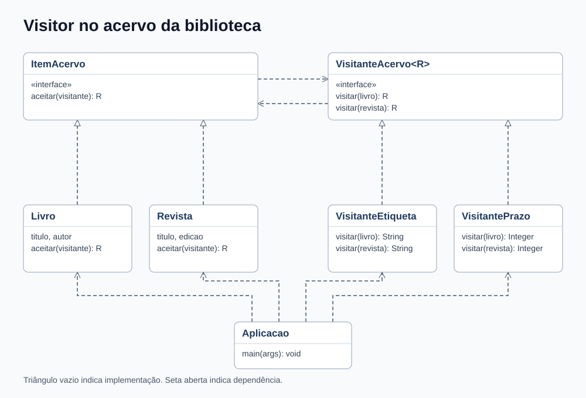

# Visitor em Java — Acervo de biblioteca

Aplicação de console que gera etiquetas e informa prazos fictícios de empréstimo para livros e revistas.

## Como rodar

Com JDK 11 ou superior, execute na raiz do projeto:

```sh
javac --release 11 -encoding UTF-8 -d out -sourcepath src/main/java src/main/java/visitor/Aplicacao.java src/test/java/visitor/VisitanteAcervoTest.java
java -cp out visitor.VisitanteAcervoTest
java -cp out visitor.Aplicacao
```

Os cinco casos automatizados verificam as etiquetas e os prazos de ambos os tipos e o processamento de uma lista mista. Qualquer divergência encerra a execução dos testes com erro.

## Onde o Visitor é aplicado

`Livro` e `Revista` implementam `ItemAcervo`. Cada classe implementa `aceitar` chamando `visitante.visitar(this)`. O tipo concreto de `this` determina qual sobrecarga de `visitar` é chamada. A implementação do visitante determina a operação executada. Essa combinação é o duplo despacho.

`VisitanteEtiqueta` retorna uma etiqueta em texto e `VisitantePrazo` retorna o prazo em dias. Uma nova operação pode ser implementada em outro visitante usando os mesmos itens do acervo.


